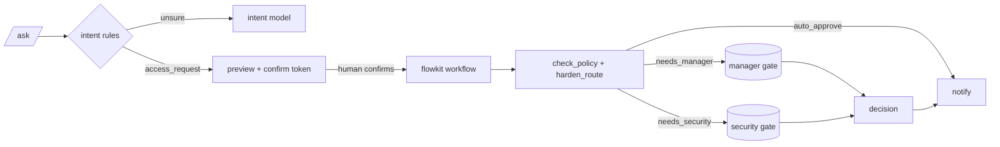

# ADR-0001: A fixed workflow with LLM steps, not an agent, for access requests

- Status: accepted
- Date: 2026-11-02
- Deciders: Company Brain (the owner, course project F1)
- Related: arch/company_brain.arch.yaml (components workflow, intake_llm, confirm_gate, approval_ui), lesson 15 (agentkit), lesson 16 (flowkit), lesson 18 (multikit), cbrain/router.py

## Context and problem statement

Company Brain מקבל בקשות גישה בטקסט חופשי ("I need a Figma editor seat", "צריכה הרשאת admin ב-GitHub"), בערך 9 ביום ב-200 עובדים. כל בקשה צריכה להגיע לאחד משלושה מסלולים של מדיניות SaaS Access v2.2 (auto_approve, needs_manager, needs_security), לחכות לאדם הנכון כשצריך, ולהשאיר audit מלא (SPEC-006 REQ-8 עד REQ-11). טעות לכיוון המקל (auto_approve לבקשה של needs_security) היא אירוע אבטחה; טעות לכיוון המחמיר עולה למנהל דקה. הבקשה עצמה כתובה בידי העובד, ולכן היא קלט לא מהימן שיכול להכיל הוראות למודל. באותו שירות יש גם שאלות ידע ושאלות נתונים, והשאלה הנוספת היא איך להחליט לאיזה מסלול הודעה הולכת.

השאלה: האם בקשת גישה מטופלת על ידי סוכן עם כלים (לולאה שבה המודל בוחר את הצעד הבא), או על ידי workflow קבוע שבו המודל רק ממלא שדות, ואיך מנתבים בין שלושת סוגי ההודעות?

## Decision drivers

- אף מודל לא מחליט על מסלול המדיניות או על אישור: מסלול שגוי לכיוון המקל הוא אירוע אבטחה, ולכן ההחלטה חייבת להיות קוד דטרמיניסטי שאפשר לבדוק.
- בקשה ממתינה לאדם שעות או ימים: צריך state עמיד שממשיך אחרי restart, לא לולאה בזיכרון.
- כל מעבר סטטוס נרשם ב-audit, וכל החלטה נבדקת מול המדריך הארגוני (REQ-8, REQ-9).
- עלות וזמן: בקשה צריכה לעלות פחות מ-0.003$ ולהגיע לשער האישור תוך פחות מ-5 שניות ב-p95.
- טקסט זדוני בבקשה יכול להשפיע לכל היותר על השדות שחולצו, ואלה מוצגים לעובד לפני הגשה.

## Considered options

### Option A: Fixed workflow with LLM steps (flowkit on LangGraph)

גרף קבוע: intake (המודל מחלץ IntakeRequest עם llmkit.structured), enrich (כלים), policy (check_policy, קוד), file_request (תופעת לוואי עם idempotency key), שערי אישור עם interrupt, apply_decision ו-notify. המודל מופיע בשני מקומות בלבד: חילוץ השדות וסיכום סיכון לסוקר האבטחה. checkpoints ב-SQLite אחרי כל צעד.

- Good, because המסלול נקבע בקוד (check_policy + harden_route), ויש לו בדיקות: 20 בקשות עם מסלול וסטטוס זהב, ו-9 החלטות שבודקות REQ-8 ו-REQ-9.
- Good, because interrupt ו-checkpoint נותנים המתנה של ימים, המשך אחרי קריסה, ו-audit עם מזהים דטרמיניסטיים.
- Good, because קריאת מודל אחת או שתיים לבקשה, כ-0.0003$ לפי מודל העלות.
- Bad, because בקשה שלא מתאימה לגרף (למשל "תעביר את ההרשאות של נועה לדנה") נגמרת ב-needs_info ולא נפתרת לבד.
- Bad, because כל צעד חדש הוא שינוי קוד בגרף, לא שינוי פרומפט.

### Option B: An agent with the Acme tools (agentkit loop)

סוכן עם lookup_employee, get_system_info, list_access_grants, check_policy ו-create_access_request, תקציב צעדים, ואישור אנושי לפני הכלי שכותב. המודל מחליט אילו כלים לקרוא ומתי לסיים.

- Good, because גמיש: מטפל גם בבקשות מורכבות או מרובות מערכות בלי לשנות קוד.
- Bad, because המודל הוא שמחליט אם לקרוא ל-check_policy ואיך לפרש את התשובה: אין ערובה שהמסלול נכון, והזרקה בטקסט פועלת על מי שמחליט.
- Bad, because המתנה של יומיים לאישור לא מתאימה ללולאה; צריך בכל מקרה state חיצוני, כלומר workflow.
- Bad, because 4 עד 8 קריאות מודל לבקשה (שיעור 15 מדד את זה), פי 4 עד 8 בעלות ובזמן.

### Option C: A supervisor agent over knowledge, data and access specialists (multikit)

supervisor שמחליט לכל הודעה איזה מומחה מטפל בה, ויכול לשלב בין כמה.

- Good, because מטפל בהודעה מעורבת ("מה הנוהל, ותגיש לי") בתשובה אחת.
- Bad, because קריאת מודל נוספת לכל הודעה, גם לשאלות פשוטות, ומקום נוסף שבו מודל יכול "לאשר" משהו.
- Bad, because אין מה לתאם בין המסלולים: בקשה הולכת ל-workflow דטרמיניסטי, שאלה לחיפוש.

## Decision outcome

Chosen option: "Option A: Fixed workflow with LLM steps", because הוא היחיד שבו מסלול המדיניות ואישור האדם הם קוד שנבדק, עם state עמיד להמתנה של ימים, בעלות של קריאה אחת או שתיים. הניתוב בין שלושת סוגי ההודעות נעשה ב-router (כללים, ומודל עם structured output רק כשהכללים לא בטוחים), לא ב-supervisor: הניתוב מגיע ל-0.95 על 40 ההודעות המתויגות עם 8% קריאות מודל. נחזור להחלטה אם יותר מ-15% מהבקשות האמיתיות יסתיימו ב-needs_info בגלל צורה שהגרף לא מכיר.

## Consequences

### Positive

- המסלול לא תלוי במודל: מודל שמציית להזרקה יכול לכל היותר לשנות את השדות שחולצו, והם מוצגים בתצוגה המקדימה לפני ההגשה. טקסט שהגלאי מסמן לא מקבל auto_approve (harden_route).
- כל בקשה ניתנת לשחזור מלא: checkpoints, audit לכל מעבר, ו-outbox אידמפוטנטי.
- הנתב זול: 92% מההודעות מנותבות בכללים, בלי קריאת מודל.

### Negative

- בקשות בצורה לא צפויה מקבלות needs_info, והעובד צריך לנסח מחדש.
- ה-FakeLLM של מצב offline לא קורא עברית עם תחילית ("ב-GitHub"), ולכן בקשה w07 נכשלת offline. Haiku צריך לעבור אותה, וזה נמדד רק live.
- התצוגה המקדימה מריצה את החילוץ פעם נוספת (קריאה כפולה לכל בקשה). אפשר לחסוך אותה בהעברת התוצאה ל-workflow, במחיר של צימוד בין השניים.

## Cost and latency

לפי מודל העלות (python -m cbrain cost, archkit על arch/company_brain.arch.yaml): בקשה עולה כ-$0.00032 (תצוגה מקדימה, חילוץ, וסיכום סיכון ב-40% מהבקשות), כלומר כ-$0.06 לחודש ב-200 עובדים. agent של שיעור 15 עם 4 עד 8 קריאות היה עולה בערך פי 5. זמן: offline, p95 של התחלת בקשה הוא כ-60 ms בלי מודל; עם Haiku ההערכה היא כ-2.5 s לחילוץ, כלומר p95 של כ-5 s לתצוגה מקדימה ועוד ריצה (יעד ה-SLO). את המספרים החיים מודדים ב-traces באבן דרך 10.

## Confirmation

- 20 הבקשות של eval ה-workflow: מסלול וסטטוס נכונים ב-19 לפחות מתוך 20 offline, ו-20 מתוך 20 live.
- 9 החלטות אישור: 100% נכונות, כולל 4 הסירובים הצפויים (מאשר לא נכון, אישור עצמי, דחייה בלי הערה, מנהל על בקשת אבטחה).
- אפס בקשות needs_security שאושרו בלי החלטה של צוות האבטחה, בבדיקה חודשית של ה-audit.
- ניתוב: דיוק של 0.90 לפחות על routing.jsonl, ופחות מ-15% קריאות מודל.

## Diagram (optional)

